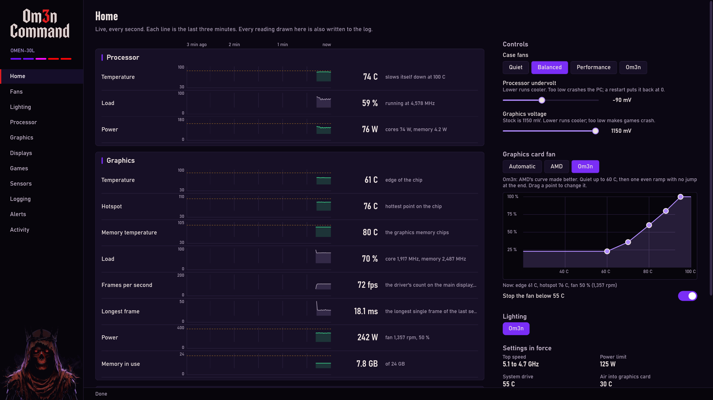

# Om3n Command

A control app for the HP OMEN 30L desktop: case fans, lighting, processor tuning, Radeon tuning and features,
display settings, live sensors and a recorder that keeps 14 days of readings. It replaces OMEN Gaming Hub and
AMD Software for those jobs and needs neither running. It is plain Windows PowerShell 5.1: `install.ps1` copies
its scripts into place and nothing else is installed.

> [!WARNING]
> **One model only.** It was written for and tested on one PC: an HP OMEN 30L (board 8703, BIOS F.30) with an
> Intel i7-10700K and a Radeon RX 7900 XTX. The fan, case lighting and memory commands talk to that board's
> BIOS and that case's lighting controller and do not carry over to another model. On any other PC, read
> [A different PC](#a-different-pc) first.
>
> **At your own risk.** Undervolting, clock and power limits and fan settings can crash a PC or let it run hot.
> Nothing here is stored in the BIOS, so a restart undoes an undervolt, but there is no warranty of any kind
> (see [LICENSE](LICENSE)).

## What it looks like

A tour of the eleven pages, ten seconds each. Click it to open it full size.



One page at a time, full size: [Home](assets/screenshots/home.png) | [Fans](assets/screenshots/fans.png) | [Lighting](assets/screenshots/lighting.png) | [Processor](assets/screenshots/processor.png) | [Graphics](assets/screenshots/graphics.png) | [Displays](assets/screenshots/displays.png) | [Displays, the monitors' own menus](assets/screenshots/displays-menu.png) | [Games](assets/screenshots/games.png) | [Sensors](assets/screenshots/sensors.png) | [Logging](assets/screenshots/logging.png) | [Alerts](assets/screenshots/alerts.png) | [Activity](assets/screenshots/activity.png)

## The pages

| Page | What you do there |
|---|---|
| Home | Every reading live with its last three minutes, and the controls you reach for most |
| Fans | Quiet, Balanced, Performance, or Om3n, which switches between the three by processor temperature |
| Lighting | Saved looks, each light's color and effect, the lights at the sign-in screen and during sleep |
| Processor | Top speed by busy cores, undervolt, memory speed |
| Graphics | Radeon features, power and clock limits, undervolt, the fan curve, 3D settings |
| Displays | Brightness, contrast, color, HDR and scaling for each monitor through the driver, then each monitor's own menu over DDC/CI: HP's gaming settings on an OMEN, brightness, contrast and color on any monitor |
| Games | A game's graphics settings as it keeps them on disk, a tuned set for this card with Apply and Revert, and what each FSR mode renders at your monitor's size |
| Sensors | Every reading with its lowest, highest and average |
| Logging | What the recorder wrote down over the last hour or up to seven days, crash and driver reset reports |
| Alerts | When the app tells you a reading runs hot |
| Activity | Every command the app has run, and what came back |

Everything the app does is one `om3n-command.ps1` command, so all of it can also be typed or scripted.

## How it works

Nothing here is borrowed from a vendor library at run time. Each control was found by reading what HP, Intel and
AMD ship on the PC, then proven by sending the same thing from this tool's own code and reading the result back.
This section is the map: what each page talks to, and how that was found.

| What | Talks to | How it was found |
|---|---|---|
| Fan mode, memory profile, RAM lighting | HP's BIOS, through its WMI class `hpqBIntM` | Gaming Hub's own log prints every BIOS command it sends; the ACPI tables and the BIOS image say what the firmware does with them |
| Case lighting | A USB device inside the case (`VID_103C&PID_84FD`), written with `WriteFile` | The 62-byte command laid out from the types in HP's lighting library, read without running it |
| Processor limits and undervolt | Intel's tuning service, a WCF service on a named pipe | The service contract re-declared in a few lines of C#, so no Intel library is loaded |
| Radeon tuning, features, displays | AMD's driver libraries `atiadlxx.dll` and `amdadlx64.dll` | Structures and call positions from AMD's public headers and samples |
| Sensors | Windows' own counters: ACPI thermal zones, the processor's energy meter, storage reliability, GPU engine counters | A survey of every counter the PC offers with no driver installed |
| Game settings | The game's own settings file | The keys are Unreal Engine's scalability groups; what each one changes was measured in play |
| The monitor's own menu | The monitor itself over DDC/CI, through Windows' Monitor Configuration API in `dxva2.dll` | HP's codes for its own settings, and the page select before a read, from Gaming Hub's monitor modules decompiled with ILSpy; the Windows side from `dxva2.dll` decompiled with Ghidra |

### Reading the vendor's app without running it

OMEN Gaming Hub is .NET with its names intact. A small script walks a method's intermediate language and prints
every call, string and constant in it, which is how the exact bytes of each command were obtained without
running a single one. Gaming Hub's background log confirms them: it prints each BIOS command as it sends it,
and the first command this tool ever sent was one taken from that log, answered byte for byte as logged.

### Fans: a BIOS call, and why there is no custom curve

A fan mode is one WMI call to the BIOS: command `0x20008`, type `0x1A`, two data bytes, `0xFF` and the mode
(`0x10` Quiet, `0x20` Balanced, `0x30` Performance). The BIOS has no read-back, so the tool keeps the mode it
last set and the sound of the fans is the confirmation.

Whether a custom speed or curve is possible was settled in the firmware rather than guessed. The ACPI tables
were copied out of the registry and decompiled: of the 41 command types the handler accepts under `0x20008`,
36 are stubs that return zeros, and the per-fan commands HP's code knows (`0x2C` to `0x2F`) have no handler at
all, which is why they answer return code 3. The BIOS image itself (HP keeps the running copy on the EFI
System Partition) was unpacked and its WMI module disassembled: the fan-mode handler compares the byte with
exactly those three values and programs the fan controller through I/O ports, which user-mode code cannot
touch. So the curve lives in the firmware, and the only honest "custom profile" is the one the Fans page
offers: Om3n, which switches between the three modes by processor temperature.

One more measurement shaped that page: a spinning highest-priority thread showed that every fan-mode call
stops the whole PC for about 0.35 s, in firmware, where nothing in Windows can shorten it. Om3n therefore goes
up a mode at once and comes down only after a full minute of readings has asked for it.

### Lighting: the controller's own command

The case lights are a USB HID device. HP's library builds a 62-byte command (length, command type, mode,
colors as red-green-blue triples, brightness, zone, theme, speed, direction) and writes it with `WriteFile`;
the device reports 58-byte reports, so that is what reaches it. The tool builds the same bytes and writes them
through SetupAPI and `hid.dll` alone: every effect, the four built-in themes, several colors per zone,
brightness, what a zone shows while the PC sleeps, and the two fed effects (system vitals once a second, and an
audio pulse from Windows' own playback meter or a loopback capture split into bass and treble).

RAM lighting is a different path: nine register writes to the memory modules' lighting controller, each one a
BIOS WMI call (`0x20009`, type `0x0A`), in the sequence HP's code sends. A static color, color cycle,
breathing, blinking and wave are the register tables from that code.

### Processor: Intel's service, without Intel's library

Intel's tuning service listens on a named pipe as a WCF service. Its contract carries no serialization
attributes, so types with the same names, namespaces and members produce the same messages: the tool declares
the contract and its data types in its own C#, opens a channel factory and calls the service directly. Writes
are a proposal followed by an apply, and three rules came out of testing them:

- The service can add controls of its own to a proposal. The tool reads every control before and after an
  apply and lists what changed, and puts back the one the service flips on its own.
- The library's own `Initialize` call discards any pending proposal from another client, so it is never used.
- The tool refuses to apply while any control already has a proposed value different from its active one.

The pipe refuses network logons, so this and the Radeon commands run in the signed-in desktop session; a
one-shot scheduled task (`run-interactive.ps1`) is how a command gets there from anywhere else.

### Radeon: the driver's two interfaces

Tuning goes through ADL, the C interface AMD ships in `atiadlxx.dll`: one call returns the card's 77
Overdrive settings with their ranges, and one call writes a settings table of value, requested and reset
flags, following AMD's own Overdrive 8 sample for this card generation. The fan curve is ten of those settings
sent together, and sending the curve with the reset flag hands the fan back to the driver. Sensors come from
`ADL2_New_QueryPMLogData_Get`.

Features and 3D settings use ADLX, which has no C exports beyond initialize and terminate: everything else is a
C++ object, a pointer to a table of functions. The tool calls them by position, with the positions computed
from the method tables in AMD's headers, which is how Anti-Lag, Chill, sharpening, Super Resolution, Fluid
Motion Frames, Enhanced Sync, anti-aliasing and the per-display settings are read and written from PowerShell.

### The monitor's own menu

A monitor's menu is reachable from the PC over DDC/CI, a two-wire channel inside the video cable, and Windows
exposes it as the Monitor Configuration API: a capabilities string that lists the codes a monitor accepts, and
a read and a write per code. The standard codes (brightness, contrast, the three color gains, sharpness, input)
work on any monitor that lists them, which is how the two Dells get their rows.

HP's gaming settings use HP's own codes, and several settings share one code through a page: to read one, the
page number is written to the code with its top bit set, then the code is read and the answer carries the page
in its high byte and the value in its low byte; to set one, the page goes in the high byte of the value written.
The codes, pages and values came from Gaming Hub's monitor modules, decompiled to C# with ILSpy: the earlier
method of walking a method's intermediate language missed the arithmetic between a read and a write, and the
decompiled source showed it in one line. Adaptive-Sync, for instance, is a word the monitor reports as Off only
when it is 0 or 6, and is written as 0 or 1 while under 6 and as 6 or 7 from there. Ghidra on `dxva2.dll`
showed that each of its calls hands straight to the same `gdi32.dll` entry point HP's app calls, so there is
no second path to try when a monitor ignores a write: the OMEN 34c accepts the Shadow Vision and edge
precision writes and keeps its value, and Gaming Hub's own support table offers those two on six other models,
so the app shows them without a switch. Black stretch, which Gaming Hub has no setting for, was found by
dumping every code the monitor lists before and after the level was changed on its joystick: the one line
that differed was the standard code `0x2E`, 2 at Medium and 3 at High (`om3n-command.ps1 monitor -Dump`).
On the Displays page a monitor's own-menu rows sit in that monitor's section: the driver side reads each
display's EDID (AMD's `ADL2_Display_EdidData_Get`, as its EDID sample does) and the cable side asks Windows for
the monitor behind each screen (`WmiMonitorID`), and the two are paired by the serial both carry, so two
monitors of the same model never swap.

### Sensors with nothing installed

Every reading on Home and Sensors comes from Windows itself: the ACPI thermal zones (the processor zone tracks
the package within about 3 C), the processor's energy meter counters, per-thread load and frequency, memory,
the GPU engine and memory counters, each drive's reliability counters, and the Radeon's own 26 sensors through
the driver. What user mode cannot reach is listed in the manual: per-core temperatures, board voltages and
chassis fan speed need a kernel driver, and the tool ships none.

### The recorder, the crash report and the alerts

The app writes one row of readings per second, written through to disk so the last seconds before a freeze
survive, and keeps 14 days. At its first tick after an unclean shutdown it writes a crash report from the
kernel's own event: bugcheck code, minidump, the last three minutes of readings and the settings in force. The
Logging page reads those files with a compiled reader that cuts any range to 400 buckets keeping each bucket's
lowest and highest value, so a one-second spike is still visible across seven days. Alerts are a pure decision
function fed the same snapshot every second: a reading over its limit for 30 s raises one notice, then nothing
for 15 minutes unless the stronger limit is reached.

### Keeping settings in force

Gaming Hub re-sends its stored settings at moments measured from 14 days of its own log: at its start, at
unlock and from its tuning page. Hold my settings checks at those moments (5 s after an unlock, 60 s after the
app starts, and every 5 minutes), compares the sign-in list with the values in force, and puts back what moved.
After an unclean shutdown the undervolt lines are held back once, so a PC that crashed does not crash again at
the next sign-in.

### Games

A game's settings are read from its own file for every installed copy (Steam and Epic share one, the Xbox app
has its own). The tuned set and what each key changes were measured in play with the recorder running, which
is also how the By resolution section tells you whether the card was power-limited in your last session: a
session averaging four fifths of the card's typical board power at high load has nothing left to give to
lower settings, and only fewer rendered pixels or a higher power limit move the frame rate.

### The app itself

The window is WPF built from XAML strings in Windows PowerShell 5.1, so nothing is compiled or installed. Every
page reads one JSON document from the command-line tool and every button runs one of its commands, judged by
exit code; the Activity page is that journal. A self-test loads every page off screen with live data and saves
a picture of each, which is where the screenshots above come from, and the published copy of the source is
produced by a script that strips comments and checks the export before it leaves.

## What it needs

- Windows 10 or 11 with Windows PowerShell 5.1 (built in), and an administrator account.
- **Case lighting** needs nothing: `om3n-command-hid.ps1` writes to the lighting controller (a USB device inside the
  case) itself. No part of this tool loads anything from OMEN Gaming Hub any more.
- **CPU tuning** needs Intel's tuning service (`XTU3SERVICE`, installed as "Intel Extreme Tuning Utility"), the same
  service Gaming Hub uses for its CPU settings.
- **Radeon commands** need the AMD driver.
- Fans, RAM lighting, memory profile and sensors need nothing but Windows and this BIOS.

## Install, update, repair, uninstall

Each is one script at the top of the download, run in **PowerShell as administrator** (right-click PowerShell,
then Run as administrator) from inside the unpacked folder. If PowerShell refuses to run a script, start it as
shown, with `-ExecutionPolicy Bypass`.

**Install.** Unpack the whole download anywhere, then:

```powershell
powershell -ExecutionPolicy Bypass -File .\install.ps1
```

It copies the app to `C:\Program Files\Om3n Command`, creates the default lighting look if you have none, registers
the two tasks that start the app, puts the `Om3n Command` shortcut on your desktop and starts the app in the
notification area. The unpacked folder can be deleted afterwards. On a PC that is not an HP OMEN 30L (board 8703)
it warns and carries on: the fan, lighting and memory commands will not work there.

**Update.** Unpack the new download and run `install.ps1` from it again. It ends the running app, replaces the
files, removes files the new release no longer has, and starts the app again. Your saved looks, sign-in list, logs
and recorded readings are never overwritten.

**Repair.** When the app no longer starts, the shortcut does nothing, or a task is missing:

```powershell
powershell -ExecutionPolicy Bypass -File "C:\Program Files\Om3n Command\repair.ps1"
```

That registers every task again, rewrites the shortcut, puts the default look back if the looks file is gone,
checks every installed script and restarts the app. If a file itself is damaged (the check at the end names it),
run `repair.ps1` from a freshly unpacked download instead: it also replaces every installed file.

**Uninstall.**

```powershell
powershell -ExecutionPolicy Bypass -File "C:\Program Files\Om3n Command\uninstall.ps1"
```

It ends the app, lets OMEN Gaming Hub, HP's services and AMD Software start with Windows again if the app had
stopped them (without the app nothing else sets the fans or the lighting; `-KeepVendorOff` leaves them as they
are), removes the tasks and the shortcut and deletes `C:\Program Files\Om3n Command`. Your settings, logs and
recorded readings stay in `C:\ProgramData\SkYn3tLab`, so a later install picks them up; add `-RemoveData` to delete
them too. The fan setting and any undervolt stay as they are until Windows is restarted: neither is stored in the
BIOS, so a restart clears both.

## A different PC

Unless your PC is the same model with the same parts, expect to change the code before it is useful to you:

- **Fans, case lighting, memory speed** are tied to the OMEN 30L's board (8703) and case. On another model they
  do nothing or fail, and need that model's own BIOS commands and lighting controller.
- **The Graphics and Displays pages** go through AMD's driver, not this board, but have only been run on a
  Radeon RX 7900 XTX.
- **The Processor page** goes through Intel's tuning service, but has only been run on an i7-10700K.
- **Sensors, Logging and Alerts** read what Windows and the graphics driver offer.

If you get it working on your PC, please send the change back, so the next person with your model starts from
your work and not from nothing:

1. **Fork** this repository (the Fork button at the top of its GitHub page) to get your own copy.
2. Make your changes there, on a branch named for your model.
3. Open a **pull request** from that branch to this repository. Say which model and board you tested on (the
   board is what `(Get-CimInstance Win32_BaseBoard).Product` prints in PowerShell), what works and what does not.

A change is merged when it leaves the OMEN 30L working, so keep what is specific to your model behind a check
for your board. If you only found out what fails on your PC, open an **issue** with the same details: that is
useful too.

## The manual

[docs/MANUAL.md](docs/MANUAL.md) has every command and option, what each file is, where settings and logs
are kept, what the app does after a crash, and what this PC cannot do.

## License

[MIT](LICENSE).
