

  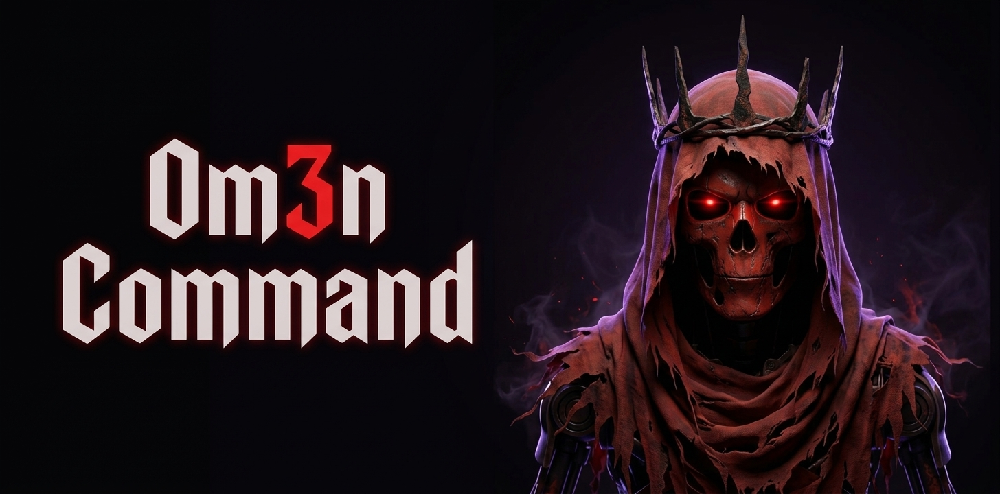

<h1 align="center">Om3n Command</h1>

<b>The free, open-source replacement for OMEN Gaming Hub on HP OMEN desktops with an Intel processor and an AMD Radeon card.</b> 
Fans, lighting, undervolting, Radeon tuning, per-game profiles and live sensors in one fast Windows app.

  
  
  
  

<a href="../../releases/latest"><b>Download the Setup</b></a> | <a href="docs/MANUAL.md">Manual</a> | <a href="CHANGELOG.md">Changelog</a>

## Why Om3n Command

OMEN Gaming Hub is heavy, slow to open and wants to run all the time. Om3n Command does the jobs people actually use it for, and nothing else.

- **Nothing else has to run.** It needs no OMEN Gaming Hub and no AMD Software running beside it.
- **Everything in one place.** Case fans, case, RAM and graphics card lighting, processor limits and undervolt, Radeon tuning, monitor settings, game profiles and sensors share one window and one look.
- **See what is happening.** A live Home dashboard, a sensors page, and a background recorder with charts that keeps 14 days of readings.
- **Safe to experiment.** Voltages, speed and power limits are changed in exact steps within what your hardware allows, and a voltage change puts the old value back by itself unless you keep it within 15 seconds. Undervolts and limits are not written to the BIOS, so a restart always returns to stock.
- **Free and open.** MIT licensed, with no account to create.

## What you can do with it

### Home: everything live, with the controls you use most

Every reading with its last three minutes as a chart, colored green, amber and red against its limits, next to the fan, undervolt, fan curve and lighting controls.

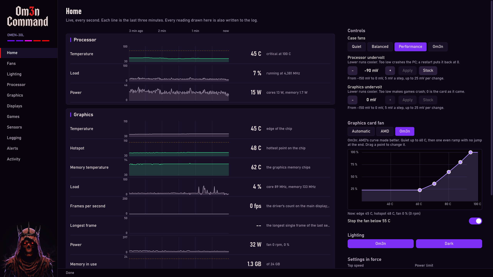

### Fans: Quiet, Balanced, Performance, or Om3n

Pick one of the three case fan modes, or let **Om3n** switch between them for you by processor temperature: quiet when idle, louder only when the processor needs it.

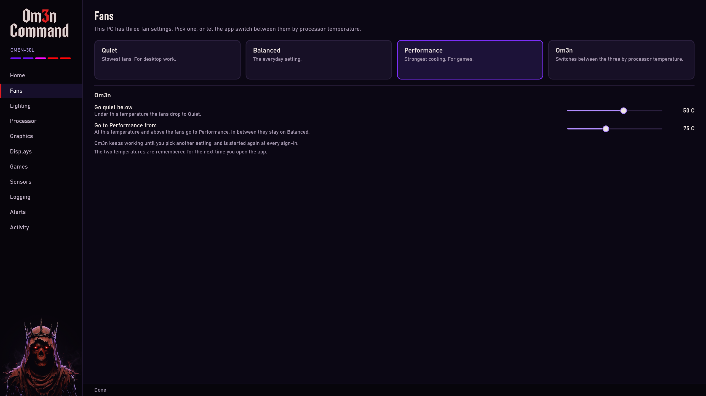

### Lighting: case, RAM and graphics card

Saved looks, a color and an effect for each light, lighting at the sign-in screen and while the PC sleeps, and live effects that follow temperature, load or the sound playing on the PC. On AMD's own Radeon RX 7900 XTX card, the Dark look turns the card's light off too, and any other look gives it back the color you set in AMD's lighting program. The app never changes what is saved on the card.

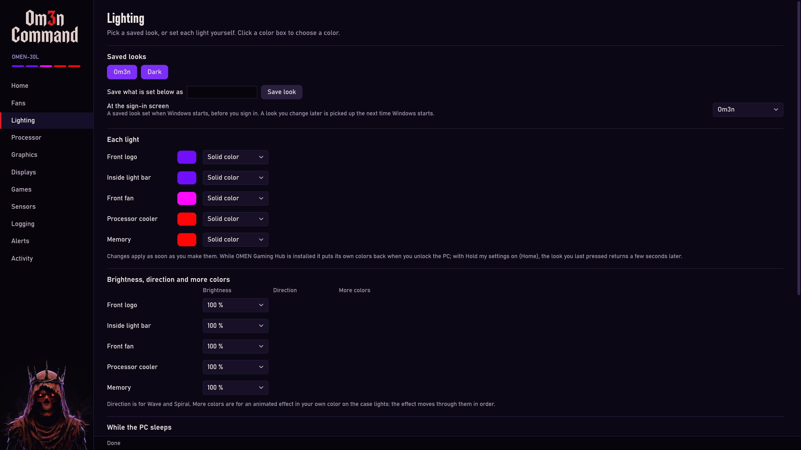

### Processor: speed limits and undervolt

Set the top speed by number of busy cores and a voltage offset (undervolt) through Intel's tuning service, with the option to apply your values again at every sign-in.

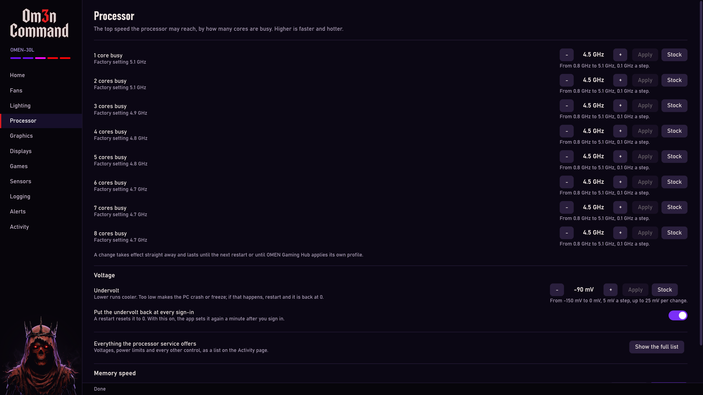

### Graphics: Radeon tuning and driver features

Undervolt, power limit, clock limits and a draggable fan curve, plus the driver features gamers reach for: sharpening, frame rate limit, Anti-Lag, Chill, Super Resolution and Fluid Motion Frames.

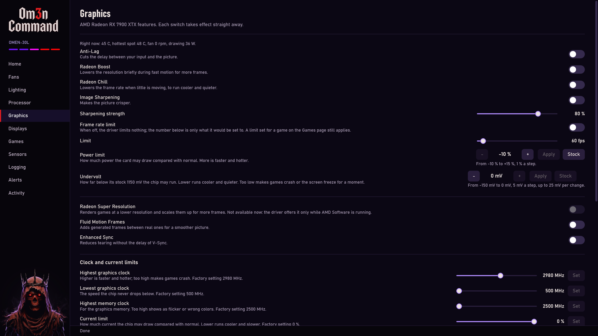

### Displays: picture settings for every monitor

Brightness, contrast, color, HDR and scaling for each monitor, and each monitor's own on-screen menu settings from your desk.

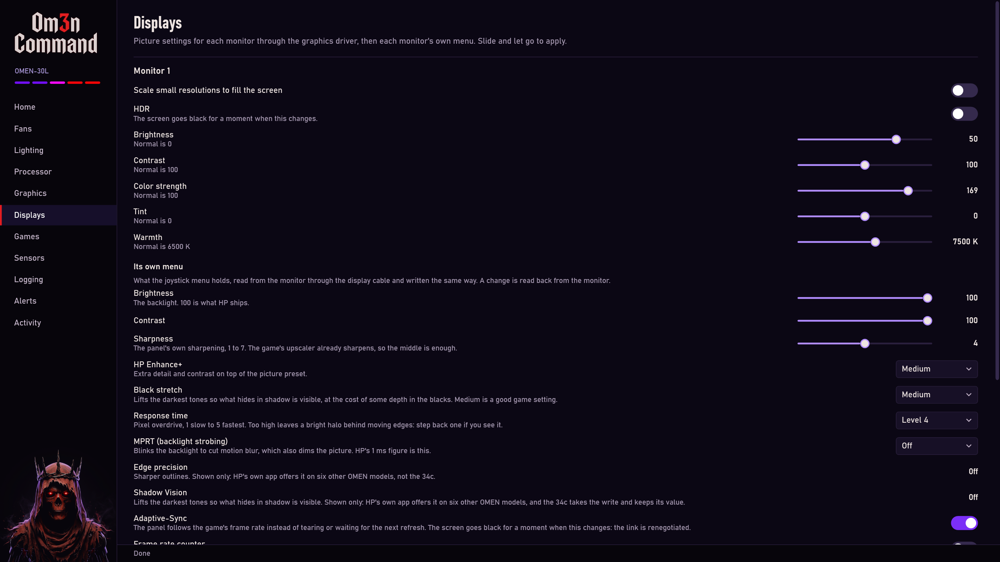
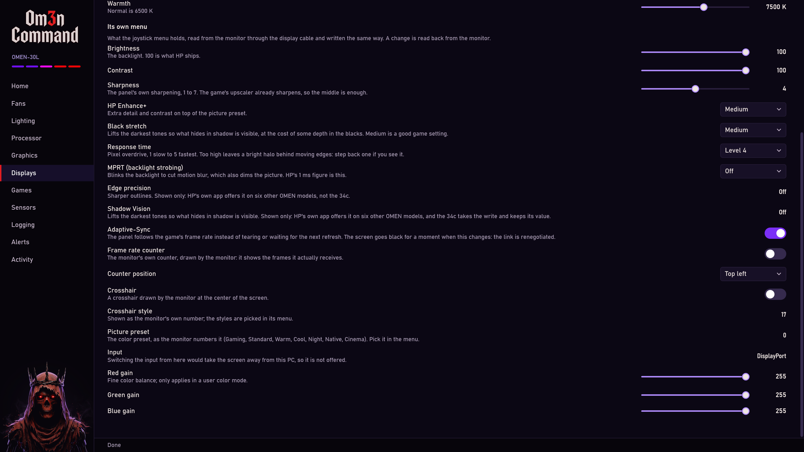

### Games: per-game profiles

ARC Raiders and Battlefield 6, on every store copy found: each game's graphics settings read from its own file, a tuned set with Apply and Revert, and what each FSR mode renders at your monitor's size.

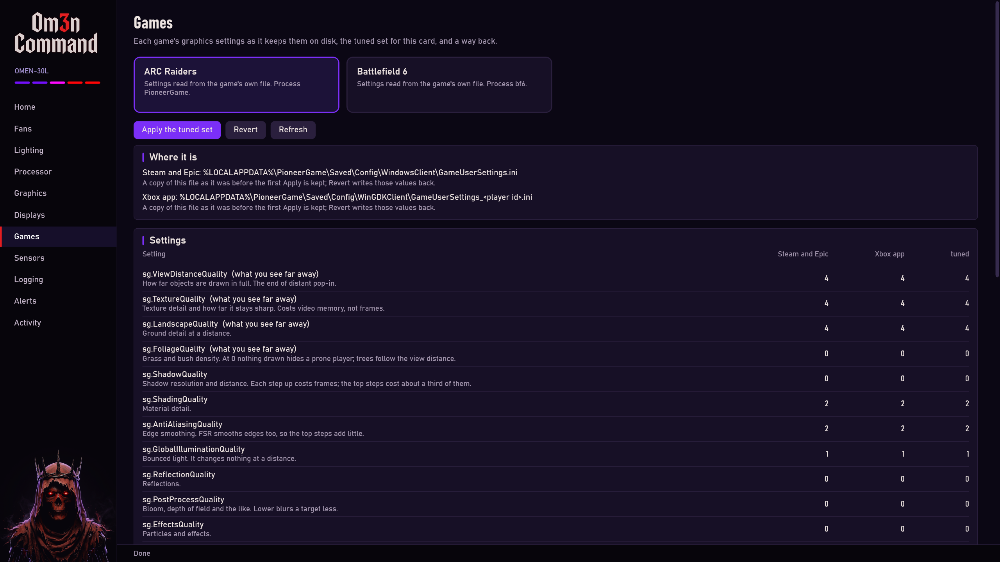

### Sensors, Logging and Alerts

Every reading with its lowest, highest and average; charts of the last hour up to 7 days with crash and driver-reset reports; and temperature alerts that tell you when something runs hot.

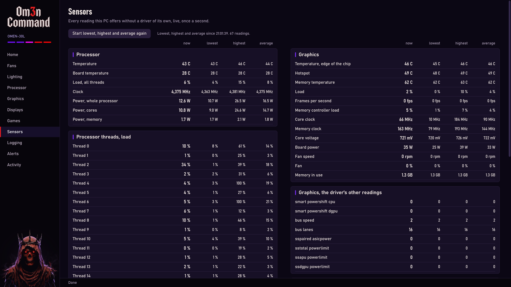
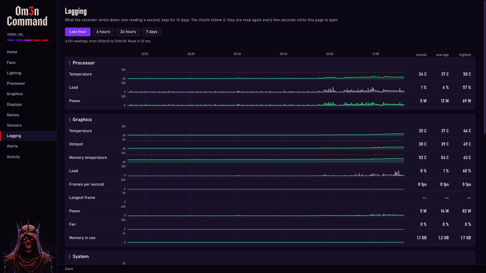
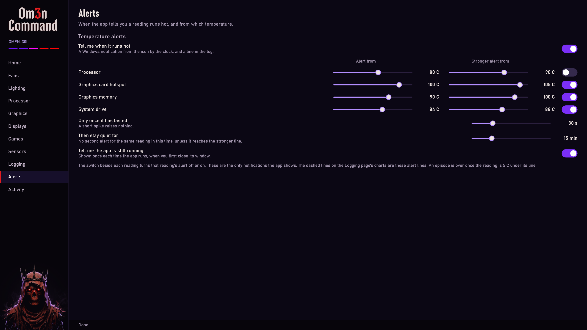

### Activity: a record of everything it did

Every command the app has run and what came back, so a change is never a mystery.

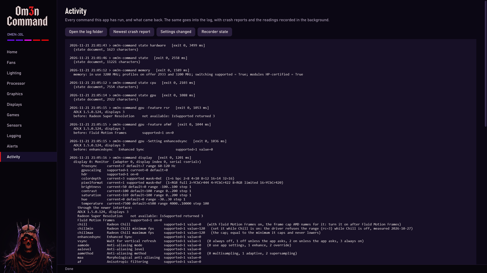

It lives in the notification area by the clock as a tray icon, starts with Windows and opens with no administrator prompt each time.

## Install

1. Download `om3n-command-setup-<version>.exe` from the [latest release](../../releases/latest).
2. Run it and accept the administrator prompt.

That is all. Om3n Command appears in the Start menu, on the desktop and in Settings > Apps, and starts with Windows. The Setup is not code-signed, so SmartScreen may say it does not recognize it: choose More info, then Run anyway. Each release lists the Setup's checksum in `sha256sums`.

Update by running a newer Setup: your saved looks, sign-in list, logs and recorded readings are kept.

## Requirements

- An HP OMEN desktop with an **Intel** processor and an **AMD Radeon** graphics card. The app reads every limit from the PC it runs on, so it is not tied to one model.
- Windows 10 or 11, 64-bit, and an administrator account.
- **Processor tuning** uses Intel's tuning service (installed with Intel Extreme Tuning Utility).
- **Graphics and display tuning** need the AMD driver.
- Fans, case lighting, memory speed and sensors need nothing else. The graphics card's light needs the AMD driver and AMD's own RX 7900 XTX card.

It was built and tested on an OMEN 30L with an Intel Core i7-10700K and a Radeon RX 7900 XTX.

## Safety

Undervolting, clock and power limits and fan settings can crash a PC or let it run hot if set badly. Om3n Command is built to make that hard:

- Voltages, speed and power limits are changed in exact steps, never dragged, and only within the range your processor and graphics card report. An undervolt moves at most 25 mV per change.
- After a voltage change, press Keep within 15 seconds or the old value comes back by itself, the way Windows handles a screen resolution change.
- Undervolts and limits are not stored in the BIOS. A restart always comes back at stock, so a bad value cannot stop the PC from starting. (The memory speed is a BIOS setting, and the app asks before changing it.)
- After an unclean shutdown, the app holds your undervolt back once so a PC that crashed does not crash again at the next sign-in, and it writes a crash report from the readings just before.
- Start with a small undervolt, test it under load, and raise it a step at a time. The manual describes a built-in A/B test that measures what an offset does on your PC.

There is no warranty of any kind (see [LICENSE](LICENSE)). You use it at your own risk.

## Security

- **No network.** The app makes no network connection: no account, no updates in the background, nothing sent anywhere. (The optional crash-analysis tool in `tools` downloads Windows debug symbols from Microsoft when you run it.)
- **Only administrators can change it.** The app lives in `C:\Program Files\Om3n Command`, and its settings folder, `C:\ProgramData\SkYn3tLab`, is set so that only administrators and Windows can change it, and no other account on the PC can read it: not its logs, its settings or its recorded readings.
- **Nothing loaded from where a program could plant it.** Every part that runs with administrator rights loads Windows' libraries only from System32, PowerShell modules only from Windows' own folders, and compiles its helpers in a folder only administrators can write.
- **Commands it runs at sign-in are checked first.** Lines in the sign-in list and in lighting looks run only if they're commands the app itself writes.
- **Built on your PC.** `Om3n Command.exe` is compiled during install from the source in the download, with the compiler that ships with Windows. The download contains no prebuilt program apart from the Setup.

Found a security problem? Report it privately on the repository's **Security** tab (**Report a vulnerability**), not in a public issue.

## FAQ

**Is it really free?** Yes. MIT license, no account, no payment.

**Do I need OMEN Gaming Hub installed?** No. Om3n Command talks to your PC directly. Gaming Hub can stay installed or go; the app can also stop Gaming Hub, HP's services and AMD Software from starting with Windows, and put them back on uninstall.

**Does it work with an NVIDIA card or an AMD processor?** No. It is for Intel processors and AMD Radeon graphics. The Graphics page uses AMD's driver and the Processor page uses Intel's tuning service.

**Why does Windows ask me to run as administrator?** Tuning needs administrator rights. Om3n Command starts as an on-demand scheduled task, so you are not prompted each time you open it.

**Does an undervolt survive a restart?** Only if you turn on "apply at every sign-in". Otherwise a restart returns to stock.

**Can I set a custom fan curve for the case fans?** The BIOS offers three fan modes and no other fan command, so the case fans cannot take a custom curve. Om3n mode switches between the three by temperature. The Radeon card's own fan does take a custom curve.

**Where are my settings and logs?** In `C:\ProgramData\SkYn3tLab`, which an update never replaces.

**It does not work on my PC. What now?** Open an issue with your model and what failed. If you fix something, a pull request is welcome.

## Uninstall

Settings > Apps > Om3n Command > Uninstall. It asks whether to delete your settings, logs and recorded readings as well, and lets OMEN Gaming Hub, HP's services and AMD Software start with Windows again if the app had stopped them. The fan setting and any undervolt stay until Windows restarts. Both the Setup and the uninstaller take `/S` to run without asking anything.

## More

[docs/MANUAL.md](docs/MANUAL.md) has every command, option and file, what the app does after a crash, and what an OMEN cannot do. What changed in each version is in [CHANGELOG.md](CHANGELOG.md).

## License

[MIT](LICENSE). Copyright SkYn3t Lab.
